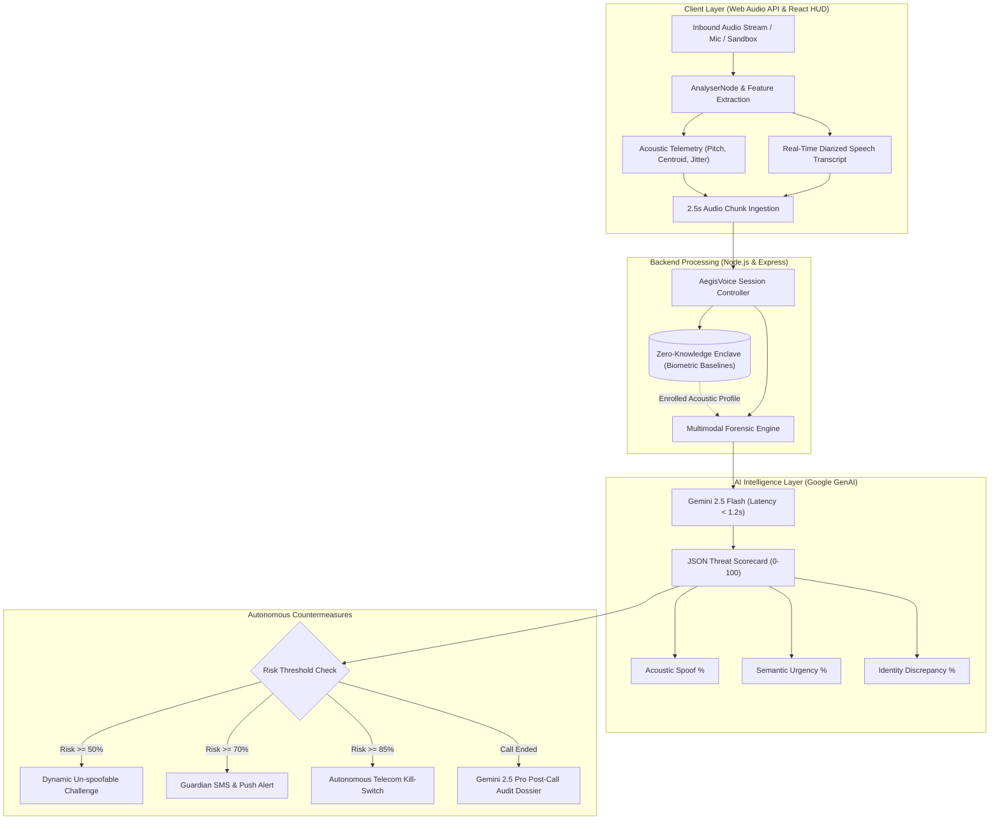

# AegisVoice AI — System Architecture & Project Documentation 🛡️

**Real-Time Multimodal AI Guardian for Cloned Voice Detection, Explainable Risk Scoring, and Autonomous Scam Defense**

---

## 1. Executive Summary & Problem Statement

### The Threat Landscape
The democratization of generative AI speech synthesis (e.g., ElevenLabs, Tortoise, VALL-E, diffusion vocoders) allows threat actors to generate photorealistic voice clones from as little as **3 seconds of public audio** scraped from social media. 

Scammers weaponize these synthetic voices in high-urgency, panic-inducing social engineering attacks:
- **Grandparent / Bail Ransom Scams**: Impersonating a grandchild claiming arrest or injury, demanding immediate wire transfers or cryptocurrency bail.
- **Financial Imposter Scams**: Posing as a senior bank fraud officer instructing victims to move life savings into a "safe federal vault account."
- **Executive CEO Wire Fraud**: Calling junior accounting personnel to demand emergency vendor gift card redemption codes during alleged "closed-door investor sessions."

Traditional security measures (such as SMS 2FA, caller ID spoofing filters, and post-transaction fraud analysis) fail because the **victim voluntarily authorizes the transaction under psychological coercion**.

### The Solution: AegisVoice AI
AegisVoice AI acts as a **real-time in-band guardian** operating side-by-side with incoming calls. It extracts low-level acoustic anomaly signatures (vocoder jitter, robotic spectral flatness, pitch constancy) alongside real-time conversational intent transcripts, evaluates them against a **Zero-Knowledge Biometric Enclave** using **Google Gemini 2.5 Flash**, and intervenes autonomously before monetary loss occurs.

---

## 2. End-to-End System Architecture

---

## 3. Core Subsystems Deep Dive

### 3.1. Real-Time Acoustic & Biometric Ingestion Pipeline
- **HTML5 Web Audio API**: Operates an ephemeral audio context sampling at 24-bit / 48kHz with `echoCancellation` enabled while preserving high-frequency vocoder harmonics.
- **Autocorrelation Pitch Estimation**: Computes fundamental frequency ($F_0$) cycles across sliding time-domain buffers to detect unnatural pitch constancy ($< 2.5\text{Hz}$ variance), a hallmark of parametric neural vocoders.
- **Spectral Centroid & Harmonic Jitter Calculation**: Monitors vocal tract resonance energy distribution. Cloned audio typically exhibits phase discontinuities in the $1.4\text{kHz} - 2.8\text{kHz}$ band.

### 3.2. Zero-Knowledge Biometric Enclave
- **Ephemeral RAM Buffering**: Raw audio recordings are **never written to disk**. Buffers are processed in memory and immediately garbage collected.
- **Mathematical Vector Hashing**: Enrolled contacts (children, bankers, doctors) store acoustic baselines (pitch mean, pitch variance, spectral centroid mean, zero-crossing rate) alongside a salted **SHA-256 biometric fingerprint**.
- **Shared Secret Verification**: Users register un-guessable family memories (e.g., *"Where did we take the rowboat in 2023?"*). The expected answers are encrypted with salted `bcryptjs` hashes.

### 3.3. Google Gemini 2.5 Flash & Pro Intelligence Engine
The system utilizes the official `@google/genai` SDK with two specialized models:
1. **Gemini 2.5 Flash (Streaming Chunks)**:
   - Low-latency (`temperature: 0.1`) processing every 2.5-second audio chunk.
   - Outputs strict, deterministic JSON containing risk scores, acoustic anomalies, coercion cues, and localized warnings.
2. **Gemini 2.5 Pro (Forensic Audit Dossiers)**:
   - Deep forensic reasoning (`temperature: 0.2`) executed upon call termination.
   - Compiles itemized acoustic, linguistic, and identity evidence into an auditable legal report with signed SHA-256 integrity hashes.

---

## 4. Threat Taxonomies & Risk Gauge Scoring

AegisVoice evaluates calls using a weighted 0–100 threat formula:

$$\text{Risk Score} = 0.40 \times \text{Acoustic Spoof} + 0.40 \times \text{Urgency Coercion} + 0.20 \times \text{Identity Discrepancy}$$

| Risk Tier | Range | Color | System State | Triggered Safeguards |
|---|---|---|---|---|
| **Safe / Verified** | 0 – 29 | Emerald Green | Normal | Quiet verification badges; normal conversation. |
| **Guarded / Suspicious** | 30 – 59 | Amber Yellow | Heightened | Yellow HUD alert; telemetry sampling rate increases. |
| **High Risk** | 60 – 84 | Orange | Warning | Spoken native warnings; Dynamic Challenge Question generated; SMS to Guardian. |
| **Critical Block** | 85 – 100 | Vivid Crimson | Autonomous Intercept | Automated telecom call termination; Banking fraud webhook dispatched. |

### Supported Threat Classifications
1. `GRANDCHILD_EMERGENCY`: Cloned grandchild claiming car accident or arrest demanding urgent cash/bail.
2. `BANK_FRAUD_IMPOSTER`: Synthetic bank officer directing funds transfer into a "safe federal vault."
3. `KIDNAPPING_RANSOM`: Frantic synthetic screaming accompanied by violent extortion demands.
4. `EXECUTIVE_CEO_FRAUD`: Cloned corporate leadership demanding gift card serial codes for vendor perks.
5. `GOVERNMENT_LEGAL_EXTORTION`: Impersonating tax or police authorities threatening immediate arrest.
6. `AUTHENTIC_COMMUNICATION`: Legitimate familial communication matching enrolled baseline frequencies.

---

## 5. User Interface & Demographic Accessibility

- **Elderly Emergency Mode**: Oversized, high-contrast visual alert banners paired with real-time text-to-speech synthesized audio alerts (via HTML5 Web Speech Synthesis API).
- **Multilingual Native Advisories**: Warnings and challenge prompts dynamically translate into **English**, **Spanish (Español)**, **Hindi (हिन्दी)**, **Mandarin (中文)**, and **Tagalog**.
- **Audio Oscilloscope & FFT Bars**: Real-time canvas rendering showing audio wave patterns and vocal jitter spikes.
- **Dynamic Challenge Modal**: Presents the user with a conversational, un-spoofable verification question with one-click *"Caller Answered Correctly"* or *"Caller Failed (Kill Call)"* buttons.

---

## 6. Preloaded Sandbox Simulator Scenarios

The platform includes 4 fully playable multi-chunk scenarios for immediate demonstration:
1. **Grandchild Emergency & Bail Ransom**: 4 chunks exhibiting $1.9\text{Hz}$ pitch constancy, manufactured arrest panic, and Bitcoin kiosk payment demands. Expected Risk: **94%**.
2. **Bank Fraud Officer Impersonation**: 4 chunks exhibiting synthetic concatenative boundaries, Title 12 banking threats, and liquidation coercion. Expected Risk: **89%**.
3. **CEO Emergency Wire & Gift Card Scam**: 4 chunks of executive authority coercion demanding twenty \$500 Apple cards over the phone. Expected Risk: **86%**.
4. **Legitimate Family Check-in**: 3 chunks demonstrating authentic human pitch variance ($19.4\text{Hz}$), peach cobbler dinner talk, and zero coercion. Expected Risk: **12%**.

---

## 7. Data Isolation & Security Architecture

- **Zero Storage of Voice Audio**: Ephemeral streaming guarantees compliance with biometric privacy regulations (BIPA, GDPR).
- **JWT Authentication**: 24-hour HMAC-SHA256 tokens validated on all protected endpoints.
- **Rate Limiting**: Tiered limits (300 requests/15m standard, 60 requests/min for streaming chunks).
- **Dual-Mode Resilient Database Layer**:
  - Connects to PostgreSQL (Supabase, Neon, Railway) via `pg.Pool` running production DDL from `schema.sql`.
  - Built-in in-browser and server-side fallback storage adapters guarantee zero downtime even on static CDN hosting.
- **Banking Fraud Webhook Security**: Dispatches payloads with signed `HMAC-SHA256` headers (`t=<timestamp>,v1=<signature>`).

