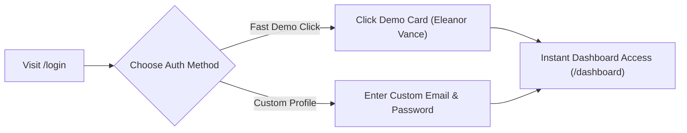
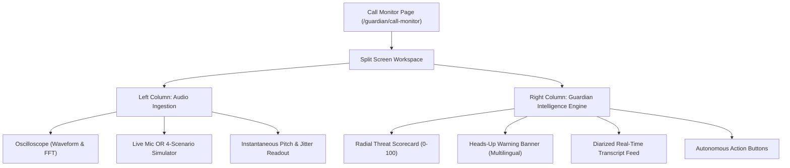

# AegisVoice AI — Complete Website Tutorial & User Manual 📖

**A Step-by-Step Interactive Guide to Every Feature, Screen, and Workflow**

> **Live Application URL**: [`https://build-to-ship-seven.vercel.app`](https://build-to-ship-seven.vercel.app)  
> **Local URL**: `http://localhost:5173`

---

## 📌 Table of Contents
1. [Tutorial 1: Getting Started & Instant Demo Authentication](#tutorial-1-getting-started--instant-demo-authentication)
2. [Tutorial 2: The Interactive Deepfake Blind Test](#tutorial-2-the-interactive-deepfake-blind-test)
3. [Tutorial 3: Managing the Zero-Knowledge Voice Enclave](#tutorial-3-managing-the-zero-knowledge-voice-enclave)
4. [Tutorial 4: Operating the Live Call Guardian HUD](#tutorial-4-operating-the-live-call-guardian-hud)
5. [Tutorial 5: Executing Autonomous Countermeasures & Challenges](#tutorial-5-executing-autonomous-countermeasures--challenges)
6. [Tutorial 6: Post-Call Forensic Incident Audit & JSON Export](#tutorial-6-post-call-forensic-incident-audit--json-export)
7. [Tutorial 7: Configuring Multilingual & Escalation Policies](#tutorial-7-configuring-multilingual--escalation-policies)
8. [Tutorial 8: Enterprise SOC Telemetry & Webhook Testing](#tutorial-8-enterprise-soc-telemetry--webhook-testing)

---

## Tutorial 1: Getting Started & Instant Demo Authentication

### Objective
Learn how to sign in, use accessibility features, and navigate using pre-configured persona profiles.

### Step-by-Step Instructions:
1. Navigate to [`/login`](https://build-to-ship-seven.vercel.app/login).
2. **Accessibility Option**: In the top-right corner of the login card, click **Large Text Mode** to increase font size and improve contrast for senior users.
3. **Instant One-Click Login**:
   - Click the **Eleanor Vance** card (Protected Senior User).
   - *Alternative*: Click **Marcus Vance** (Family Guardian) or **Dana Sterling** (Enterprise SOC Analyst).
   - *Alternative*: Enter any email/password and click **Sign In**.
4. You will be authenticated immediately with an active session token and redirected to your **Guardian Dashboard** (`/dashboard`).

---

## Tutorial 2: The Interactive Deepfake Blind Test

### Objective
Experience firsthand how difficult it is for human ears to distinguish between authentic human distress and an ElevenLabs neural voice clone.

### Step-by-Step Instructions:
1. On the public homepage ([`/`](https://build-to-ship-seven.vercel.app/)), scroll down to **"Can You Spot the Cloned Voice?"**.
2. Click **▶ Play Sample A**:
   - Listen to the audio of a crying grandchild claiming an emergency and bail need.
   - Observe the live audio oscilloscope responding to the stream.
3. Click **▶ Play Sample B**:
   - Listen to the audio of a granddaughter asking about Sunday dinner and peach cobbler.
4. **Cast Your Vote**: Click **Vote: AI Deepfake** on the sample you believe is synthetic.
5. **The Reveal**: The system displays the forensic result:
   - **Sample A** was the AI clone!
   - AegisVoice’s acoustic vocoder engine detected a **1.9Hz pitch constancy anomaly** and **robotic vocoder phase shifts in the 2.4kHz band** in under 840ms.

---

## Tutorial 3: Managing the Zero-Knowledge Voice Enclave

### Objective
Enroll trusted family members, bankers, and doctors with mathematical acoustic baselines and un-guessable shared memory secrets.

### Step-by-Step Instructions:

#### 1. Adding a Trusted Contact
1. Click **Voice Enclave** in the top navigation bar (`/contacts/enclave`).
2. Click **Add Trusted Contact** in the top right.
3. Fill in:
   - **Full Name**: e.g., *"Sarah Vance (Granddaughter)"*
   - **Relationship**: Select *Child / Grandchild*, *Parent*, *Bank Representative*, etc.
   - **Phone Number**: (e.g., `+1 (555) 345-6789`)
4. Click **Add Contact**.

#### 2. Running the 3-Step Voice Enrollment Wizard
1. On the contact card, click **Enroll Voice**.
2. **Step 1 (Calibration Prep)**: Have the contact ready to speak the sample reading sentence. Click **Begin Voice Calibration**.
3. **Step 2 (Acoustic Capture)**: The 10-second countdown runs while the Web Audio API extracts vocal tract harmonics, pitch mean, and jitter.
4. **Step 3 & 4 (Enclave Sealing)**: The system hashes the acoustic profile (SHA-256) and stores the mathematical baseline. The raw voice recording is **discarded from memory**.
5. Click **Done** to return to the contact directory.

#### 3. Configuring Shared Verification Secrets
1. On the contact card, click **Add Secret**.
2. Enter:
   - **Challenge Question**: *"Where did we spend Christmas in 2022?"*
   - **Secret Answer**: *"Lake Tahoe cabin"*
   - **Memory Hint**: *"Cabin by the lake with uncle Bob's retriever"*
3. Click **Save Secret**. The answer is securely hashed with `bcryptjs`.

---

## Tutorial 4: Operating the Live Call Guardian HUD

### Objective
Monitor an incoming call in real time, inspect the audio oscilloscope, and evaluate explainable risk scores.

### Step-by-Step Instructions:
1. Navigate to **Call Guardian HUD** (`/guardian/call-monitor`).
2. Under the **Scam Call Sandbox Simulator** box (bottom left), choose one of the 4 preloaded scenarios:
   - **Scenario 1**: *Grandchild Emergency & Bail Ransom* (Expected Risk: **94%**)
   - **Scenario 2**: *Bank Fraud Officer Impersonation* (Expected Risk: **89%**)
   - **Scenario 3**: *CEO Emergency Wire & Gift Card Scam* (Expected Risk: **86%**)
   - **Scenario 4**: *Legitimate Family Check-in* (Expected Risk: **12%**)
3. Click **Run Scenario** on **Grandchild Emergency**:
   - The simulation streams chunks every 2.8 seconds.
   - **Left Panel**: The Canvas Oscilloscope reacts with red sinusoidal harmonics. Look at the telemetry stats: Pitch drops to $189\text{Hz}$ with near-zero pitch variance ($1.9$).
   - **Right Panel**: The **Radial Threat Gauge** animates upward into the **Crimson Critical Zone (94%)**.
   - **Transcript Box**: Watch real-time diarized text stream in. Suspicious cues (`bail`, `arrest`, `Bitcoin kiosk`) are automatically highlighted.

---

## Tutorial 5: Executing Autonomous Countermeasures & Challenges

### Objective
Learn how to use dynamic shared-secret verification questions, alert emergency guardians, and engage the telecom kill-switch.

### Step-by-Step Instructions:

#### 1. Triggering the Dynamic Challenge Question
1. While a high-risk call is active, click **Ask Verification Challenge** in the Autonomous Action HUD.
2. A modal pops up showing the un-spoofable challenge:
   - *"Quick question before we do that—Where did we spend Thanksgiving two years ago?"*
   - Prompt hint: *"Cabin by Lake Tahoe with Uncle Bob"*.
3. Read the question to the caller.
   - If they pass: Click **Caller Answered Correctly** (monitoring resumes).
   - If they fail, hesitate, or make excuses: Click **Caller Failed (Kill Call)**.

#### 2. Disagreeing with the Caller & Killing the Call
1. Click **Terminate Call Immediately** (the large red button).
2. The audio stream is severed, the timer halts, and the status changes to **Call Neutralized**.

#### 3. Dispatching an Emergency Guardian Alert
1. Click **Alert Emergency Guardian**.
2. A simulated SMS/push distress packet is transmitted to the configured guardian contact phone (`+1 (555) 987-6543`) with call context.

---

## Tutorial 6: Post-Call Forensic Incident Audit & JSON Export

### Objective
Review auditable evidence compiled by **Google Gemini 2.5 Pro** and export legal forensic dossiers.

### Step-by-Step Instructions:
1. When a call terminates, click **Compile Audit Report** (or navigate to `/incidents`).
2. In the incident table, find your recent call and click **Deep Report**.
3. **Using the Synchronized Audio Replay Scrubber**:
   - Click **Play Timeline** at the top left.
   - The scrubber steps through each 2.5-second chunk.
   - Click any chunk number (`#0`, `#1`, `#2`) to jump directly to the moment vocoder jitter peaked.
4. **Inspecting Itemized Evidence**:
   - Review **Acoustic Evidence**: Phase discontinuities detected in upper harmonics.
   - Review **Linguistic Evidence**: Psychological coercion and secrecy pressure patterns.
   - Review **Identity Evidence**: Biometric cosine distance failure against registered Enclave baseline.
5. **Exporting Legal Proof**:
   - Click **Export Forensic Audit JSON** in the top right.
   - The system downloads a cryptographically signed JSON file with a SHA-256 audit fingerprint.

---

## Tutorial 7: Configuring Multilingual & Escalation Policies

### Objective
Set native spoken language advisories and customize autonomous cutoff thresholds.

### Step-by-Step Instructions:
1. Navigate to **Settings** (`/settings`).
2. **Language Selection**:
   - Select your preferred native language: **English**, **Español**, **हिन्दी (Hindi)**, **中文 (Mandarin)**, or **Tagalog**.
   - Spoken warnings and HUD alerts will now render in this language.
3. **Autonomous Threshold Sliders**:
   - Adjust the **Autonomous Call Kill-Switch Threshold** (e.g., set to `85%`).
   - Select your **Acoustic Sensitivity Policy**: *Balanced*, *Strict*, or *Aggressive*.
4. **Emergency Guardian Pairing**:
   - Update your guardian's mobile phone number for emergency SMS alerts.
   - Update your financial institution’s fraud webhook endpoint.
5. Click **Save Escalation Policies**.

---

## Tutorial 8: Enterprise SOC Telemetry & Webhook Testing

### Objective
Experience the B2B fraud analyst view and simulate dispatching telemetry packets to bank fraud desks.

### Step-by-Step Instructions:
1. Navigate to **Enterprise SOC** (`/enterprise/telemetry`).
2. **Global Threat Distribution Heatmap**:
   - Inspect the real-time breakdown of attack vectors: Grandchild Bail (34%), Bank Officer Wire (28%), Executive CEO (17%), etc.
3. **B2B Ingestion API Key**:
   - Click **Copy** next to your enterprise API key (`ag_live_sentinel_...`) to see how SIP telecom trunking routes audio.
4. **Banking Webhook Simulator**:
   - Enter your bank's mock webhook URL in the input field.
   - Click **Dispatch Test Payload**.
   - Review the verified HMAC-SHA256 signature packet rendered below.

---

## 💡 Quick Reference Shortcut Matrix

| Feature / Action | Route / Screen | Key Button / Shortcut |
|---|---|---|
| **One-Click Demo Login** | `/login` | Click **Eleanor Vance** card |
| **Elderly Emergency Mode** | Navbar (Top Right) | Click **Emergency Mode [ON/OFF]** |
| **Run Scam Simulator** | `/guardian/call-monitor` | Click **Run Scenario** on Grandchild Bail |
| **Dynamic Challenge Question** | Call Monitor HUD | Click **Ask Verification Challenge** |
| **Instant Telecom Kill-Switch** | Call Monitor HUD | Click **Terminate Call Immediately** |
| **Audit Incident Dossier** | `/incidents/:id` | Click **Play Timeline** / **Export JSON** |
| **Change Advisory Language** | Navbar or `/settings` | Dropdown selector (EN, ES, HI, ZH, TL) |
